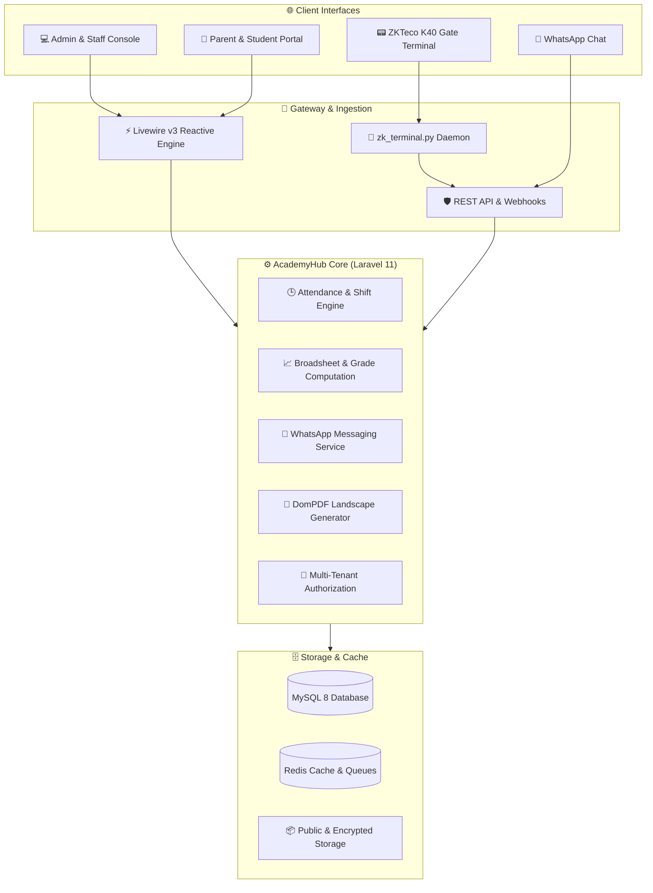

<div align="center">

  <!-- Header Banner -->
  

  <br/>

  <!-- Animated Typing Tagline -->
  <a href="https://github.com/yaseeradam/AcademyHub">
    
  </a>

  <br/><br/>

  <!-- Badges -->
  <p align="center">
    <a href="https://laravel.com"></a>
    <a href="https://www.php.net"></a>
    <a href="https://livewire.laravel.com"></a>
    <a href="https://tailwindcss.com"></a>
    <a href="https://www.mysql.com"></a>
    <a href="#-biometric-hardware-integration"></a>
    <a href="#-whatsapp-bot--notifications"></a>
    <a href="https://docker.com"></a>
  </p>

  <!-- Quick Nav -->
  <p align="center">
    <a href="#-overview"><b>📖 Overview</b></a> •
    <a href="#-key-features"><b>🌟 Features</b></a> •
    <a href="#-biometric-hardware-integration"><b>📟 Biometrics</b></a> •
    <a href="#-system-architecture"><b>📐 Architecture</b></a> •
    <a href="#-roles--permissions"><b>🔐 Roles</b></a> •
    <a href="#-quick-start--installation"><b>⚡ Quick Start</b></a> •
    <a href="#-production-deployment"><b>🚀 Deployment</b></a>
  </p>

</div>


## 📖 Overview

**AcademyHub** is an enterprise-grade, multi-tenant cloud School Management System designed for forward-thinking primary, secondary, and tertiary institutions. Built on **Laravel 11**, **Livewire v3**, and **Tailwind CSS**, AcademyHub unifies physical gate security, academic computation, parent engagement, and financial governance into a singular, lightning-fast platform.

Whether handling physical ZKTeco K40 biometric gate punches, generating instant terminal broadsheets, dispatching automated WhatsApp arrival alerts to parents, or taking daily attendance with real-time auto-saving, AcademyHub provides an unmatched educational operations experience.

---

## 🌟 Key Features

<table>
  <tr>
    <td width="50%" valign="top">
      <h3>⚡ Real-Time Attendance Consoles</h3>
      <ul>
        <li><b>Unified Modern UI:</b> Identical, high-productivity interface for both <b>Students</b> and <b>Staff/Teachers</b>.</li>
        <li><b>Instant 2×2 Touch Controls:</b> Fast marking (<i>Present</i>, <i>Absent</i>, <i>Late</i>, <i>Excused</i>) with zero-latency auto-save.</li>
        <li><b>Live KPI Dashboard:</b> 6 real-time stat cards with percentage rates and pending count indicators.</li>
        <li><b>Smart Auto-Absent:</b> 1-click batch marking with biometric punch protection so physical gate scans are never overridden.</li>
        <li><b>A4 Landscape Reports:</b> High-resolution weekly and monthly PDF exports with star punctuality ratings.</li>
      </ul>
    </td>
    <td width="50%" valign="top">
      <h3>📟 Physical Biometric Hardware</h3>
      <ul>
        <li><b>ZKTeco K40 Integration:</b> Plug-and-play biometric gate terminal connectivity via TCP/IP sockets (port 4370).</li>
        <li><b>Real-Time Gate Monitoring:</b> Live scan feed with arrival (<i>In</i>) and departure (<i>Out</i>) timestamps.</li>
        <li><b>Dual-Shift Schedules:</b> Native support for <i>Western Shift (8:00 AM)</i> and <i>Islamic Shift (12:30 PM)</i>.</li>
        <li><b>Automated Gate Daemons:</b> Python background polling daemon with automatic network reconnect and offline queuing.</li>
      </ul>
    </td>
  </tr>
  <tr>
    <td width="50%" valign="top">
      <h3>🤖 WhatsApp Bot & Instant Alerts</h3>
      <ul>
        <li><b>Arrival & Departure Alerts:</b> Sends automated WhatsApp notifications to parents the instant a student punches the gate reader.</li>
        <li><b>Interactive Chat Menus:</b> 24/7 automated parent bot for checking term results, balances, and schedules.</li>
        <li><b>School Broadcasts:</b> Mass announcement distribution for emergencies, holidays, and event reminders.</li>
      </ul>
    </td>
    <td width="50%" valign="top">
      <h3>📊 Academic Intelligence & Analytics</h3>
      <ul>
        <li><b>Automated Broadsheets:</b> Automatic position ranking, grade calculation, and GPA computation.</li>
        <li><b>Arm & Class Segregation:</b> Position and ranking calculated accurately by class arm or main school class.</li>
        <li><b>Visual Performance Trends:</b> High-contrast subject charts and term-by-term comparative trajectories.</li>
        <li><b>Smart Diagnostics:</b> Automatic detection of subject strengths (🏆 70%+) and weaknesses (⚠️ &lt;60%).</li>
      </ul>
    </td>
  </tr>
  <tr>
    <td width="50%" valign="top">
      <h3>👨‍👩‍👧 Mobile Parent & Student Portal</h3>
      <ul>
        <li><b>Multi-Child Support:</b> Single parent login to monitor all wards across different classes and sections.</li>
        <li><b>Academic History:</b> Real-time homework submissions, score transcripts, and gate attendance calendars.</li>
        <li><b>Mobile-First PWA:</b> Progressive Web App installable on iOS and Android devices for offline viewing.</li>
      </ul>
    </td>
    <td width="50%" valign="top">
      <h3>💳 Bursary & Financial Suite</h3>
      <ul>
        <li><b>Fee Billing & Invoicing:</b> Customizable fee structures per class with sibling discount support.</li>
        <li><b>Payment Receipts:</b> Instant generation of tamper-proof PDF receipts with QR verification.</li>
        <li><b>Debtors Tracking:</b> Real-time financial reports, debt aging, and cash flow ledgers for bursars.</li>
      </ul>
    </td>
  </tr>
</table>

---

## 📟 Biometric Hardware Integration

AcademyHub connects physical biometric devices (e.g., **ZKTeco K40, uFace, MB20**) directly to the cloud or local school network without expensive third-party SaaS middleware.

```
       ┌────────────────────────┐
       │   Physical ZKTeco K40  │
       │  Fingerprint / RFID    │
       └───────────┬────────────┘
                   │ TCP / Port 4370
                   ▼
       ┌────────────────────────┐
       │   zk_terminal.py       │  ◄── Background Python daemon
       │   (Local Sync Daemon)  │
       └───────────┬────────────┘
                   │ Secure HTTPS REST API
                   ▼
       ┌────────────────────────┐
       │   AcademyHub Core API  │  ◄── Dual Shift Evaluation (Western / Islamic)
       │   (Laravel 11 Backend) │
       └─────┬────────────┬─────┘
             │            │
             ▼            ▼
  ┌─────────────────┐  ┌──────────────────┐
  │ Livewire UI     │  │ WhatsApp Bot     │
  │ Real-Time Scans │  │ Instant Parent   │
  │ & KPI Counters  │  │ Arrival Alerts   │
  └─────────────────┘  └──────────────────┘
```

- **Dual-Shift Rules**: Automatically classifies arrivals as `Present` or `Late` depending on the registered staff/student shift (Western: 8:00 AM vs Islamic: 12:30 PM).
- **Anti-Override Lock**: Students and teachers verified by hardware scans cannot be accidentally overwritten as absent during manual sheet taking.

---

## 📐 System Architecture



---

## 🔐 Roles & Permissions

| Role | Badge | Access Level | Primary Capabilities |
| :--- | :---: | :--- | :--- |
| **Admin** | `Full Access` | Institution-wide | Complete system configuration, staff management, biometric settings, database backup/restore |
| **Bursar** | `Finance` | Financial modules | Fee creation, invoice assignment, payment recording, PDF receipt issuance, financial audit |
| **Teacher** | `Academic` | Allocated classes & arms | Daily student attendance, continuous assessments (CA), exam marks, homework management |
| **Parent** | `Portal` | Wards only | Real-time arrival gate notifications, term broadsheets, fee balance tracking, excuse submissions |
| **Student** | `Personal` | Personal records | Homework downloads/submissions, timetable schedules, terminal reports, attendance log |

---

## 🛠️ Tech Stack

<div align="center">

| Component | Technology | Version / Details |
| :--- | :--- | :--- |
| **Backend Framework** | [Laravel](https://laravel.com) | `11.x` (Modern Structure, PHP 8.2+) |
| **Frontend Architecture** | [Livewire](https://livewire.laravel.com) | `v3` (Reactive, Zero-SPA Complexity) |
| **Styling & Theme** | [Tailwind CSS](https://tailwindcss.com) | `3.4+` (Custom Slate/Navy Gradient Design) |
| **Database** | [MySQL](https://mysql.com) | `8.0+` (InnoDB, Full Multi-Tenancy) |
| **Biometric Integration** | Python + `pyzk` | TCP/IP Socket (Port 4370) Daemon |
| **PDF Generation** | [DomPDF](https://github.com/barryvdh/laravel-dompdf) | A4 Landscape Broadsheets & Cards |
| **Charts & Visuals** | [Chart.js](https://chartjs.org) | Dynamic Performance & Trend Graphing |
| **Containerization** | [Docker](https://docker.com) | Alpine PHP-FPM, Nginx & MySQL Stack |

</div>

---

## ⚡ Quick Start & Installation

### 📋 Prerequisites
- **PHP** `^8.2` with `pdo_mysql`, `gd`, `bcmath`, `mbstring`, `zip`, `xml`
- **Composer** `^2.5`
- **Node.js** `^18.0` & **NPM**
- **MySQL** `^8.0` or **MariaDB** `^10.4`

### 🔧 Step-by-Step Installation

```bash
# 1. Clone the repository
git clone https://github.com/yaseeradam/AcademyHub.git
cd AcademyHub

# 2. Install PHP & Node dependencies
composer install --optimize-autoloader --no-dev
npm install

# 3. Environment configuration
cp .env.example .env
php artisan key:generate

# 4. Configure your database in .env
# DB_CONNECTION=mysql
# DB_HOST=127.0.0.1
# DB_PORT=3306
# DB_DATABASE=academyhub
# DB_USERNAME=your_username
# DB_PASSWORD=your_password

# 5. Run database migrations & seeders
php artisan migrate --force
php artisan db:seed --force

# 6. Create storage symlink
php artisan storage:link

# 7. Compile frontend assets
npm run build

# 8. Start local development server
php artisan serve
```

---

## 🚀 Production Deployment (Docker)

AcademyHub is container-ready. To launch via Docker Compose:

```bash
# Build and run containers
docker-compose up -d --build

# Run migrations inside container
docker exec -it academyhub-app php artisan migrate --force

# Clear and optimize cache
docker exec -it academyhub-app php artisan optimize:clear
docker exec -it academyhub-app php artisan config:cache
docker exec -it academyhub-app php artisan route:cache
docker exec -it academyhub-app php artisan view:cache
```

### ⏱️ Cron Automation Setup
Add the Laravel scheduler to your server crontab (`crontab -e`):

```bash
* * * * * cd /path/to/academyhub && php artisan schedule:run >> /dev/null 2>&1
```

---

## 🛡️ Disaster Recovery: 1-Click Backup & Restore

AcademyHub includes an embedded, high-reliability disaster recovery module:

1. Navigate to **Admin Console** ➔ **Settings** ➔ **Backup & Restore**.
2. **Instant Snapshot**: Generates an encrypted `.zip` archive containing:
   - Full MySQL dump (`database.sql`).
   - Uploaded student photos, receipts, and media files (`public/uploads`).
3. **Automated Safety Restore**: Restoring an archive automatically enables maintenance mode, checks data integrity, performs atomic database re-import, and restores uploaded media seamlessly.

---

## 🤝 Contributing

Contributions are welcomed! Please adhere to the following workflow:

1. Fork the repository.
2. Create your feature branch (`git checkout -b feature/amazing-feature`).
3. Commit your changes (`git commit -m 'Add amazing feature'`).
4. Push to the branch (`git push origin feature/amazing-feature`).
5. Open a Pull Request.

---

## 📄 License & Credits

- **Author**: [Yasir Adam](https://github.com/yaseeradam)
- **Framework**: Powered by [Laravel](https://laravel.com) and [Livewire](https://livewire.laravel.com).
- **License**: Proprietary / Educational License. See `LICENSE` for details.

<div align="center">

  

  <p><b>Built with ❤️ for modern education excellence.</b></p>
  <p><i>© 2026 AcademyHub — Next-Gen Cloud School Management System</i></p>

</div>
